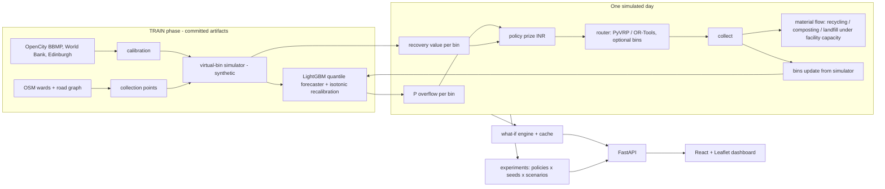

# Circular Waste Management Decision-Support System (Bengaluru case)

An AI + optimisation decision-support system for municipal waste collection: bin fill / overflow forecasting, prize-collecting vehicle routing, a material-flow
simulation (recycling, composting / biomethanation, landfill under facility capacity limits) and a what-if dashboard. The case study is two Bengaluru localities
(HSR Layout and Madiwala, OpenStreetMap suburb polygons).

> **Synthetic simulation data.** No Indian bin-level sensor data is public. All bin-level data in this repository is generated by a calibrated virtual-bin
> simulator (calibrated on BBMP / CPCB / World Bank What a Waste figures; fill-dynamics *shape* fitted on real Edinburgh bin sensors). Every file, API payload, chart and
> report that uses it is flagged `synthetic: true` and the dashboard shows a permanent notice. Several economic inputs are `TODO-SOURCE` placeholders
> ([HUMAN_TASKS.md](HUMAN_TASKS.md)): read differences between policies, not absolute rupee values.

## The claim

The contribution is **a collection prize combining predicted overflow risk with predicted composition-based recovery value**, evaluated against (a) the overflow-only prize policy of the 2024
integrated selection-and-routing paper and (b) a threshold + CVRP baseline, inside a scenario simulator that also tracks recycling, composting and landfill flows under facility capacity limits.
No novelty is claimed for prediction, for routing, or for value-aware routing in general.

| Prior work | What it already does | What it leaves open |
|---|---|---|
| [BIN-CT](https://arxiv.org/pdf/1807.01603) (Ferrer & Alba), arXiv 1807.01603 | Predicts container fill levels and routes on the predictions | Fill only; no composition or value |
| [Integrated selection and routing policy](https://arxiv.org/pdf/2409.13386) (2024), arXiv 2409.13386 | Prizes from the probability a cluster overflows before the next plan, solved as a prize-collecting VRP in a simulation | Closest baseline: overflow-risk prizes, no recovery term |
| Ramos et al., [Smart waste collection routing problem](https://www.sciencedirect.com/science/article/abs/pii/S0957417418301404) (Valorsul) | Selects which recyclable bins to visit by fill level and location | Single-stream recyclables, no composition forecasting |
| [Dynamic Multi-Compartment Vehicle Routing Problem for Smart Waste Collection](https://www.researchgate.net/publication/368558512_Dynamic_Multi-Compartment_Vehicle_Routing_Problem_for_Smart_Waste_Collection) | Maximises recyclables collected, prioritising the fullest containers | Fullness, not material value or downstream capacity |

## Quick start (no training needed)

Trained models (`artifacts/forecast/*.joblib`), the synthetic histories (`data/sim`), the cached road graph and travel-time matrices (`data/cache`), the experiment results
(`experiments/results`) and the precomputed what-if grid (`experiments/whatif_cache`) are committed, so a fresh clone runs directly.

```bash
git clone <this repo> && cd circular-waste-dss
make setup     # Python 3.11 venv + pinned requirements + npm install
make test      # pytest + TypeScript typecheck
make demo      # API on :8000 (docs at /docs) + dashboard on http://localhost:5173
```

Needs Python 3.11 and Node 18+. The dashboard works offline except for the OpenStreetMap background tiles (vector layers, routes and bins render without them).
`make demo-check` starts the API, checks `/health` and `/base`, and stops.

## What runs



Policies (selected by name in `configs/policies.yaml`):

| policy | prize per bin (INR/day) | router |
|---|---|---|
| `threshold` (Tier A) | large uniform prize if predicted fill >= 80 % | OR-Tools CVRP, guided local search |
| `overflow_only` (2024 paper style) | alpha x P(overflow) x overflow cost | PyVRP prize-collecting VRP |
| `recovery_aware` (this project) | alpha x P(overflow) x overflow cost + beta x predicted recovery value | PyVRP prize-collecting VRP |
| `value_only` | beta x predicted recovery value | PyVRP prize-collecting VRP |

`threshold_pyvrp` (same selection rule, PyVRP router) is run as a control so that router differences are not confused with policy differences. OR-Tools and PyVRP are cross-checked on random instances
([router_crosscheck.json](experiments/results/router_crosscheck.json), tested in `tests/test_route.py`).

Layout: `circwaste/{geo,sim,forecast,priority,route,flow,scenario,metrics,api}`, `configs/` (assumptions with sources, policies, loop settings), `experiments/`, `web/` (Vite + React + TypeScript + react-leaflet + recharts),
`tests/`, `docs/` (build guide, `DECISIONS.md`). State files: [PROGRESS.md](PROGRESS.md), [BLOCKERS.md](BLOCKERS.md), [HUMAN_TASKS.md](HUMAN_TASKS.md).

## Results

<!-- RESULTS:START -->
Test seeds 100-109 (10 paired seeds), 30 policy-controlled days after 30 warm-up days; mean ± std over seeds; git `7a60b47`, 2026-10-21. **Synthetic simulation data.**

| policy | overflow events | km | operating cost (INR) | recovered value (INR) | net cost (INR) | landfill diversion |
|---|---|---|---|---|---|---|
| overflow_only | 69.9 ± 9.2 | 2930 ± 14 | 116,651 ± 639 | 871,907 ± 18,668 | -720,306 ± 22,067 | 0.323 |
| recovery_aware | 56.7 ± 6.0 | 3130 ± 12 | 122,695 ± 391 | 880,620 ± 19,317 | -729,575 ± 21,231 | 0.323 |
| recovery_aware_valsel | 56.8 ± 6.4 | 3115 ± 11 | 122,323 ± 391 | 880,695 ± 19,348 | -729,972 ± 21,336 | 0.323 |
| threshold | 117.0 ± 7.1 | 3015 ± 23 | 119,615 ± 673 | 865,375 ± 18,885 | -687,260 ± 19,992 | 0.323 |
| threshold_pyvrp | 121.6 ± 7.4 | 2847 ± 16 | 114,871 ± 555 | 862,920 ± 18,874 | -687,248 ± 20,756 | 0.323 |
| value_only | 60.4 ± 5.4 | 3109 ± 13 | 122,175 ± 433 | 880,467 ± 19,333 | -728,092 ± 20,896 | 0.323 |

Paired Wilcoxon signed-rank, `recovery_aware` vs `overflow_only` (`experiments/results/main_paired_tests.csv`):

| metric | mean difference | p |
|---|---|---|
| net_cost_inr | -9,269.6 | 0.0020 |
| operating_cost_inr | 6,043.4 | 0.0020 |
| overflow_events | -13.2 | 0.0020 |
| km | 199.7 | 0.0020 |
| recovered_value_inr | 8,713.0 | 0.0020 |

Sensitivity, `recovery_aware` minus `overflow_only`, mean over the same paired seeds (`experiments/results/sensitivity_paired.csv`; negative = recovery_aware lower):

| scenario | net cost (INR) | overflow events | recovered value (INR) | p (net cost) |
|---|---|---|---|---|
| base | -9,270 | -13.2 | 8,713 | 0.0020 |
| price_-30% | -6,981 | -13.2 | 6,120 | 0.0020 |
| price_+30% | -11,835 | -13.2 | 11,337 | 0.0020 |
| forecast_error_x2 | -86,557 | -123.2 | 34,622 | 0.0020 |
| overflow_cost_x0.5 | -23,665 | -44.0 | 23,530 | 0.0020 |
| overflow_cost_x2 | -3,541 | -3.5 | 3,386 | 0.0098 |
| fleet_2_trips_per_day | -15,286 | 24.8 | 32,730 | 0.0020 |
| fleet_4_trips_per_day | -9,567 | -12.9 | 9,025 | 0.0020 |

Prices, efficiencies, fleet and facility capacities are `TODO-SOURCE` placeholders (see [HUMAN_TASKS.md](HUMAN_TASKS.md)); read the differences between policies, not the absolute rupee values. Full tables, ablation, sensitivity and plots: [experiments/results/summary.md](experiments/results/summary.md).
<!-- RESULTS:END -->

Reading the results (qualitative; the numbers are in the tables above and in `experiments/results/`):

* `overflow_only` uses a one-day horizon: bins that are unlikely to overflow *today* get almost no prize and are skipped, then pile up. Adding the recovery term (`recovery_aware`, `value_only`) makes the
  planner collect more of the bins that hold material, which reduces overflow events in the base fleet.
* `value_only` gets most of that improvement, so in the base regime the overflow term adds comparatively little on top of the value term; the alpha-beta ablation (validation seeds) shows the same flat region.
* The ordering is regime dependent. With a binding fleet (2 trips per vehicle per day) `recovery_aware` recovers more value but has *more* overflow events than `overflow_only` (see the sensitivity table);
  with doubled forecast error the overflow-only prize degrades much more than the recovery-aware prize.
* Facilities are at their placeholder capacity on most days in the base case, which caps recovered mass (and hence the landfill diversion rate) equally for every policy.
* The threshold + CVRP baseline has the most overflow events; running it with PyVRP (`threshold_pyvrp`) shows this is the selection rule, not the OR-Tools router.

Reproduce: `make experiments` (about 40 minutes on 8 cores, runs detached), then `make report`. Forecast quality (out-of-time evaluation against naive / seasonal-naive baselines, Brier score for overflow,
external check on real Edinburgh data) is in [artifacts/TRAINING_REPORT.md](artifacts/TRAINING_REPORT.md).

## API

`GET /base` (wards, points, facilities, depot), `GET /policies`, `POST /scenario` (levers -> job id; precomputed scenarios answer at once), `GET /scenario/{id}`, `GET /day/{scenario}/{day}` (routes as GeoJSON polylines
along roads, bin states, flows), `GET /experiments`, `GET /cached`. OpenAPI docs at `/docs`.

## Data sources and licences

| Source | Used for | Licence |
|---|---|---|
| OpenStreetMap (via OSMnx) | wards, roads, buildings, waste points | ODbL - (c) OpenStreetMap contributors, shown on every map |
| OpenCity BBMP SWM data | facilities, composition, plant capacities | maps Public Domain; check per file |
| World Bank What a Waste 2.0 | per-capita generation | CC BY 4.0 |
| Edinburgh litter-bin sensors (aileenmcd/bin_project) | fill-dynamics shape | OGL v3 |
| Melbourne smart-bin data | planned, no longer published (see BLOCKERS.md) | - |

Checksums and retrieval dates: [data/SOURCES.csv](data/SOURCES.csv). Software credits: [CREDITS.md](CREDITS.md).

## Limitations

* Bin-level data is simulated; the forecaster is trained and tested on synthetic data (only the Edinburgh check uses real sensors, and only for the fill-noise shape).
* Persons per building area, festival uplift, segregation rate, recovery efficiencies, material prices, overflow cost, fleet, bin sizes and facility capacities are placeholders until sourced (`TODO-SOURCE`).
* Wards are OSM suburb polygons, not BBMP's official ward boundaries; facilities lie outside the study graph (haversine x detour legs).
* Chronos-2 is evaluated in the training report only; the daily loop uses LightGBM (torch and LightGBM cannot share a process on macOS).
* The OR-Tools baseline stops on a wall-clock limit, so its solutions can differ slightly between machines; PyVRP runs use a fixed iteration budget.
* Whether recovery-aware prizes beat overflow-only prizes depends on how binding the fleet and the facilities are; see the sensitivity tables rather than a single number.
